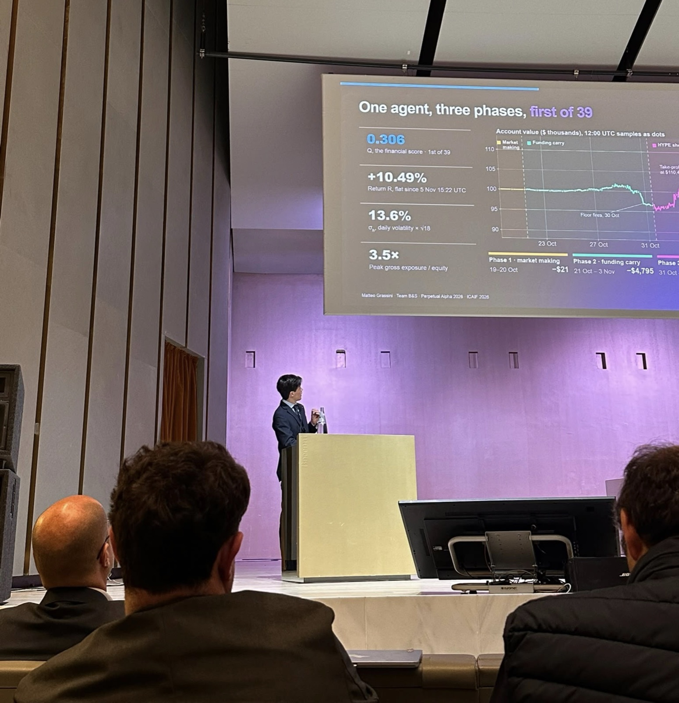
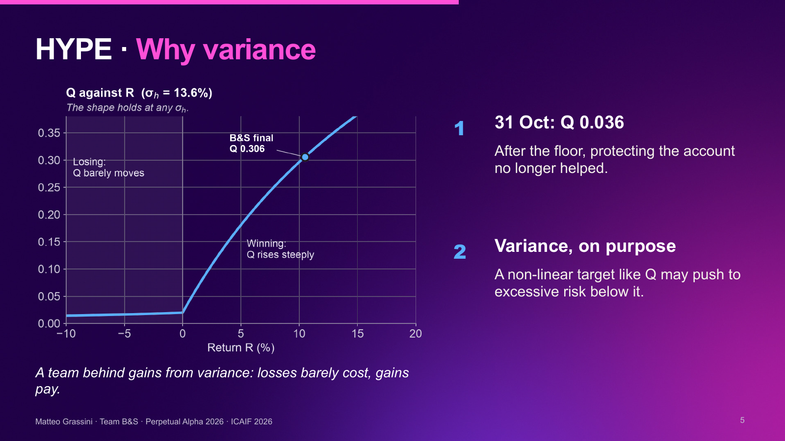
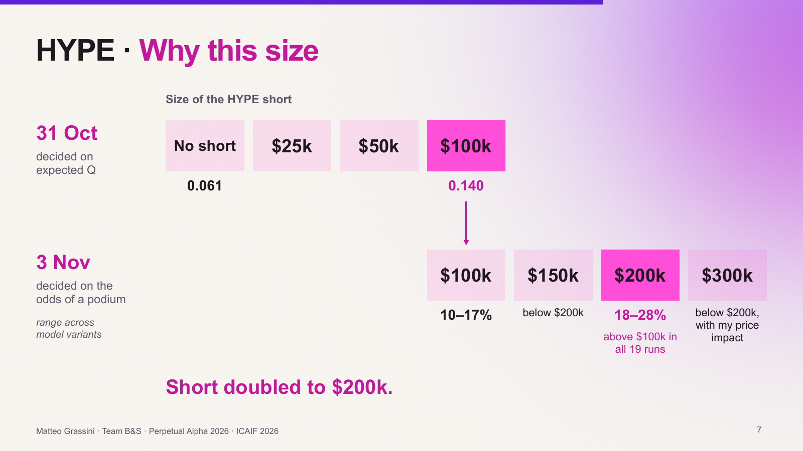
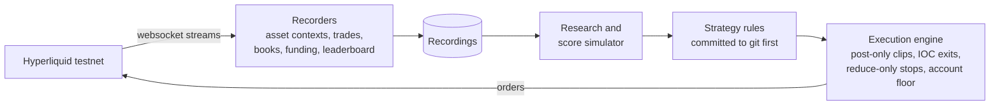
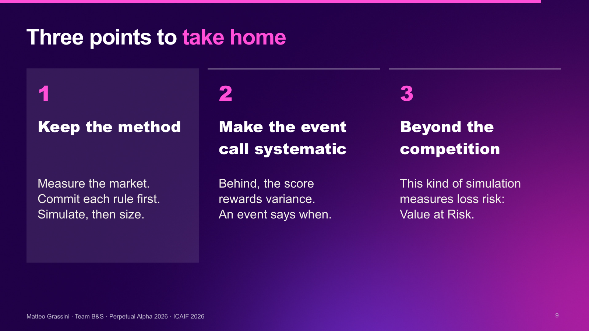

<p align="center">
  
</p>

<h1 align="center">Perpetual Alpha 2026 · Team B&amp;S</h1>

<p align="center">
  <b>An autonomous trading agent on Hyperliquid testnet, designed and run by one person.</b><br>
  Official competition of ACM ICAIF 2026, the International Conference on AI in Finance, Milan.
</p>

<div align="center">

| 2nd overall | 1st of 39 | +10.49% | Sole developer |
|:---:|:---:|:---:|:---:|
| one of three finalists,<br>final score 0.3677 | on the risk-adjusted<br>financial score, Q = 0.306 | return over the<br>scored phase | agent, research<br>and every decision |

</div>

---

## The competition

[Perpetual Alpha](https://perpetual-alpha26.github.io) asked teams of one to four people to build
autonomous agents and run them live on the Hyperliquid testnet, a decentralized perpetual futures
exchange, from **19 October to 6 November 2026**. Every team started from a \$100,000 testnet
account and traded on the same order books, against the other teams and the organizers'
market-making bots.

The ranking combined a financial score and a jury score:

```math
\text{Score} = 0.8\,Q + 0.2\,J, \qquad Q = \frac{\max(R,0) + 0.005}{|R| + 1.5\,\sigma_h + 0.05}
```

where $R$ is the return of the scored phase, $\sigma_h$ the daily volatility scaled to the horizon,
and $J$ the jury's assessment of code, report and presentation. Of the 39 teams on the final
leaderboard, three were invited to present at the final, in the Aula Magna of Bocconi University
on 15 November.

## Result

| Final ranking | Final score | Financial score Q |
|:---|:---:|:---:|
| 1. BerserkerBots | 0.3858 | 0.292 |
| **2. B&S** | **0.3677** | **0.306, highest of 39** |
| 3. Secretive Plotter | 0.3671 | 0.274 |

B&S finished the trading phase with the highest financial score of all 39 ranked teams: **+10.49%**
with $\sigma_h$ = 13.6%. The jury component decided the final order.

## One agent, three phases

<p align="center"></p>

The agent is rule-based: on one to ten days of recordings a fitted model would have fitted noise.
It ran three strategies in turn on the same execution engine.

| Phase | Dates | Idea | Net |
|:---|:---|:---|---:|
| **1 · Market making** | 19-20 Oct | Quote both sides around a fair value, skewed against inventory. Stopped on day two: 90 of 92 fills went to one fast wallet trading on the oracle's lag, most likely the organizers' market maker. | -\$21 |
| **2 · Funding carry** | 21 Oct - 3 Nov | Hold the side the hourly funding pays, mostly SP500 long, under rules committed to git before each decision. It earned \$1,998 of funding but lost on price, and an account floor closed it on 30 October. | -\$4,795 |
| **3 · HYPE short** | 31 Oct - 5 Nov | A deliberate variance bet, sized by simulating the score, closed by a take-profit at \$110,000. | +\$15,307 |
| | | **Total, fees included** | **+\$10,491** |

## Simulate the score, then size

<p align="center"></p>

Every sizing decision went through a **Monte Carlo simulator of the competition score itself**,
not of P&L alone:

- **Markets:** 1-hour blocks of joint returns, resampled at the same hour for all assets so that
  correlations are kept, with drift removed.
- **The other teams:** daily returns drawn from a Student t with 4 degrees of freedom at each
  team's published volatility; the leading teams through their public positions, on the same paths.
- **The decision:** 12,000 to 40,000 paths with common random numbers. Options are compared by
  paired differences, on expected Q or on the probability of a podium, so shared noise and equal
  biases cancel. Each comparison is re-run under model variants (funding, drift, volatility,
  impact) to check that the winner does not change.

The rule behind the whole project: **measure the market, commit each rule first, simulate, then size.**

## The HYPE short

The result rests on one call, and it is worth explaining in full.

<table>
  <tr>
    <td width="50%"></td>
    <td width="50%"></td>
  </tr>
</table>

- **Why variance.** Q is almost flat below $R = 0$ and steep above it. After the floor of 30
  October the account was behind (Q = 0.036), so losses barely cost and gains paid: the push to
  risk below a target studied by Barucci and Lan (2025). The position was taken as a variance bet,
  openly.
- **Why short, why HYPE.** The side came from a macro view on the US midterms of 3 November
  (a Democratic sweep would weigh on data centers, then on US tech, then on crypto) and from HYPE
  being the most volatile market that could take the size: on the tariff shock of 10 October 2025
  it fell 15.0%, against 7.3% for bitcoin and 3.5% for the Nasdaq-100. A view, not a tested
  edge: one election is one observation.
- **Why this size.** \$100k on 31 October, where the simulator moved expected Q from 0.061 with no
  short to 0.140. Doubled to \$200k on 3 November, where it raised the simulated podium odds from
  10-17% to 18-28%, ahead in all 19 model variants.
- **The exit.** 2,434 HYPE sold in 274 fills at an average of 85.86, bought back at 79.51 in
  47 fills when the take-profit fired on 5 November at 15:22 UTC. The account stayed flat until
  the final sample.

<p align="center"></p>

**The honest limit:** without the short, $R$ would have been -4.82%, and the only measured
edge, the funding carry, was crowded. The next step is to make the event call systematic: map
events such as elections and tariffs to positions tested out of sample, instead of relying on
macro judgment.

## How it was built



- **Stack:** Python on the Hyperliquid SDK, with pandas, NumPy and statsmodels for the analysis.
- **Infrastructure:** a Linux VPS under systemd, restarted 30 seconds after any failure. At start
  the engine adopts the stops already resting on the venue, so a restart neither doubles an order
  nor leaves a position uncovered.
- **Execution:** entries post-only until a deadline, exits crossing in clips; half of the 1,204
  fills paid the maker fee.
- **Risk:** per-market notional targets, each simulated for its floor risk, reduce-only stops
  resting on the venue, and an account floor that closes everything.
- **AI, outside the agent:** sub-agents audited the data, simulated the score and reviewed every
  change. The trading agent itself makes no LLM calls: it is deterministic code on the server.

<p align="center"></p>

## The talk

The strategy was presented at the final of ACM ICAIF 2026, in the Aula Magna of Bocconi
University, on 15 November 2026. The full deck is in
[`docs/ICAIF-2026-talk-BS.pdf`](docs/ICAIF-2026-talk-BS.pdf).

<p align="center"></p>

## What is not in this repository

> [!NOTE]
> The source code, the recorded market data and the full technical report are kept private.
> I am happy to walk through the design, the score simulator and the decision record in
> conversation.

---

<p align="center">
  <b>Matteo Grassini</b> · MSc Mathematical Engineering (Quantitative Finance), Politecnico di Milano<br>
  <a href="https://www.linkedin.com/in/matteograssini04">LinkedIn</a>
</p>
