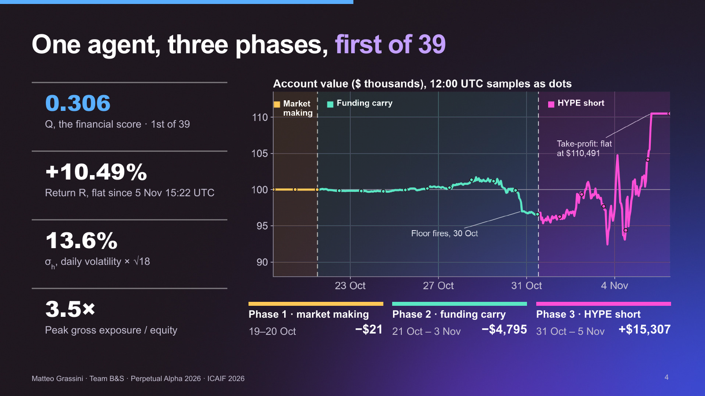
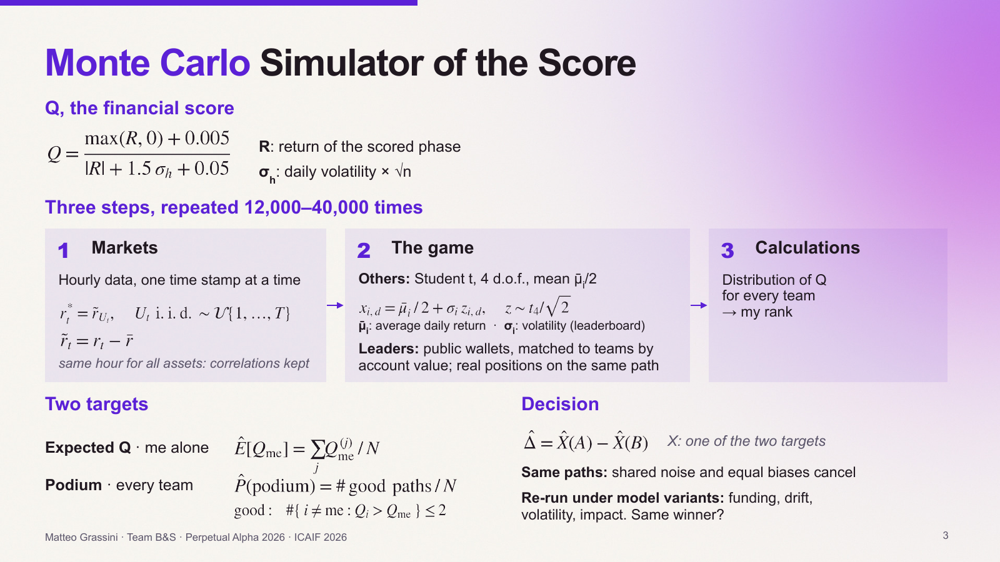
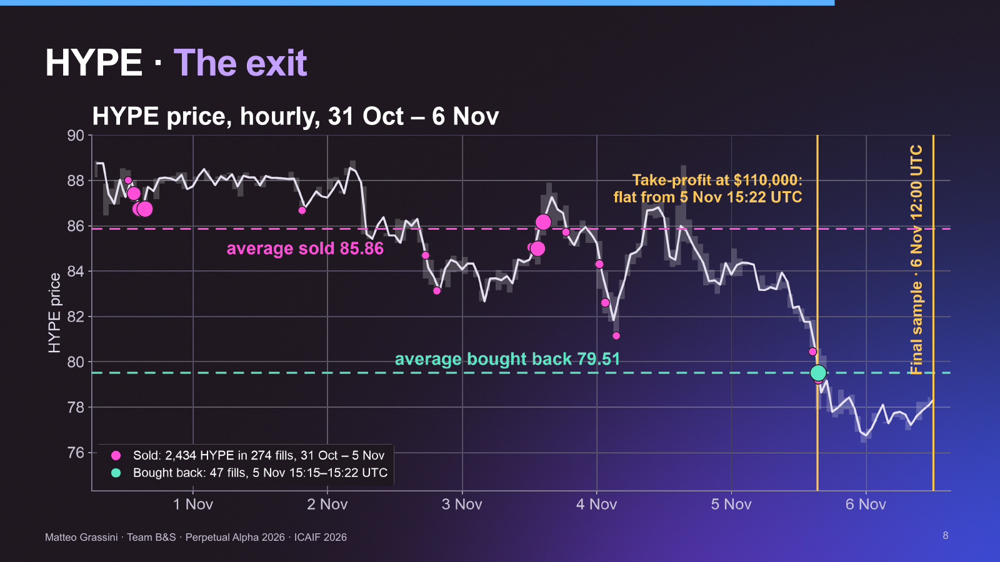
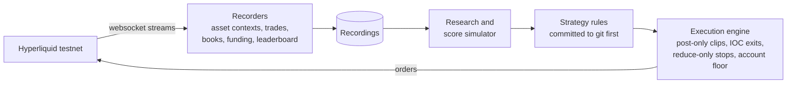
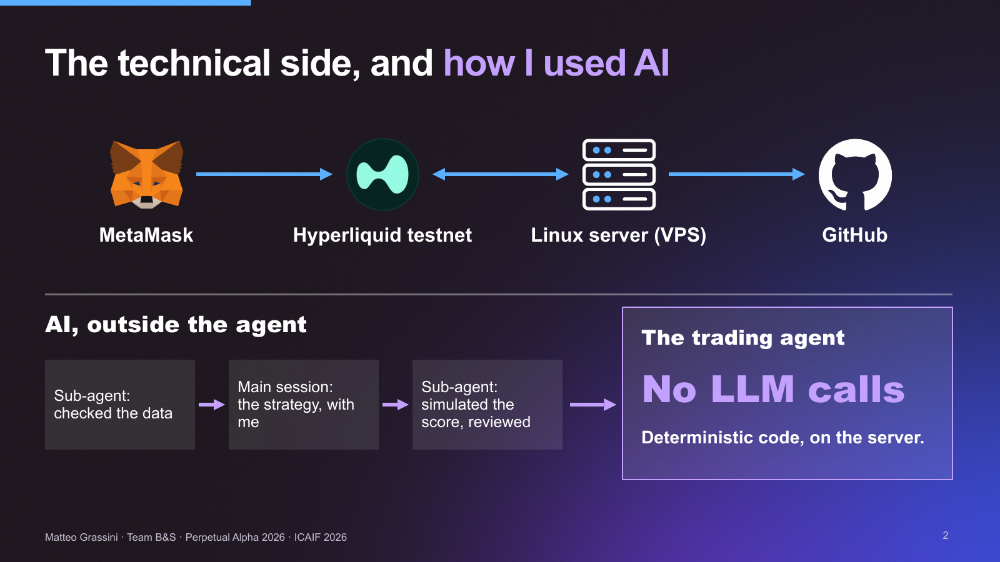

<p align="center">
  
</p>

<h1 align="center">Perpetual Alpha 2026 · Team B&amp;S</h1>

<p align="center">
  <b>An autonomous trading agent on the Hyperliquid testnet, designed and run by one person.</b><br>
  Part of the ACM ICAIF 2026 Competition Track, the International Conference on AI in Finance, Milan.
</p>

<div align="center">

| 2nd overall | 1st of 39 | +10.49% | One-person team |
|:---:|:---:|:---:|:---:|
| one of three finalists,<br>final score 0.3677 | on the risk-adjusted<br>financial score, Q = 0.306 | return over the<br>scored phase | strategy, research and decisions;<br>code written with Claude Code |

</div>

---

## The competition

[Perpetual Alpha](https://perpetual-alpha26.github.io) asked teams of one to four people to build
autonomous agents and run them live on the Hyperliquid testnet, a decentralized perpetual futures
exchange, from **19 October to 6 November 2026**. Every team started from a \$100,000 testnet
account and traded on the same order books, against the other teams and the organizers'
market-making bots.

```math
\text{Score} = 0.8\,Q + 0.2\,J, \qquad Q = \frac{\max(R,0) + 0.005}{|R| + 1.5\,\sigma_h + 0.05}
```

where $R$ is the return of the scored phase, $\sigma_h$ the daily volatility scaled to the horizon,
and $J$ the expert jury's score. Of the 39 ranked teams, the three with the highest $Q$ presented
at the final, in the Aula Magna of Bocconi University on 15 November.

## Result

| Final ranking | Final score | Financial score Q |
|:---|:---:|:---:|
| 1. BerserkerBots | 0.3858 | 0.292 |
| **2. B&S** | **0.3677** | **0.306, highest of 39** |
| 3. Secretive Plotter | 0.3671 | 0.274 |

B&S finished the trading phase with the highest financial score of the 39 ranked teams:
**R = +10.49%** with $\sigma_h$ = 13.6%. Maximum drawdown -13.6% (10-minute values, 4 November),
peak gross exposure about 3.5 times equity. The jury score decided the final order.

## One agent, three phases

<p align="center"></p>

The agent is rule-based. Fitted models were tested first and failed their declared out-of-sample
tests: an OLS nowcast of fair value (Diebold-Mariano t = 1.08 against a bar of 2) and 22 trend
variants chosen on 2020-2023 data (best t = 1.28 against 2). The agent placed every order on its
own; which strategy ran, and the side and size of the HYPE short, were my decisions. It ran three
strategies on the same execution engine, and the carry and the HYPE short overlapped from
31 October to 3 November.

| Phase | Dates | Idea | Net |
|:---|:---|:---|---:|
| **1 · Market making** | 19-20 Oct | Quote both sides around a fair value, skewed against inventory. Stopped on day two: 90 of its 92 maker fills went to one fast wallet trading on the oracle's lag. | -\$21 |
| **2 · Funding carry** | 21 Oct - 3 Nov | Hold the side the hourly funding pays, mostly SP500 long: +\$1,998 funding, -\$5,814 price, -\$979 fees. An account floor closed it on 30 October; it re-entered that evening at \$250k without a floor and left by its funding rule on 3 November. | -\$4,795 |
| **3 · HYPE short** | 31 Oct - 5 Nov | A declared variance bet, sized by simulating the score: \$100k, then \$200k. Closed by a take-profit at \$110,000. | +\$15,307 |
| | | **Total, fees included** | **+\$10,491** |

Behind the carry: the venue's funding rule, recovered from its data and exact to 5×10⁻¹¹ over
316 hours per market.

## Simulate the score, then size

<p align="center"></p>

Sizes were chosen with a **Monte Carlo simulator of the competition score itself**, not of P&L
alone. In its final form, from 31 October:

- **Markets:** 1-hour blocks of joint returns, resampled at the same hour for all assets so that
  correlations are kept, with drift removed.
- **The other teams:** daily returns drawn from a Student t with 4 degrees of freedom at each
  team's published volatility; the leading teams also through their public positions, used only
  inside the simulator.
- **The decision:** 12,000 to 40,000 paths with common random numbers. Alternatives fixed before
  the runs are compared by paired differences, on expected Q or on the probability of a podium,
  so the Monte Carlo noise they share cancels. The absolute podium odds were optimistic against
  the live ranking, so only the differences were used. Each comparison was re-run under model
  variants (funding, drift, volatility, impact) to see whether the winner changes.

The method: **measure the market, commit each rule to git before it trades, simulate, then
size.** Seven times I deviated from a declared rule; each deviation is in git with its reason.

## The HYPE short

The result rests on one call, and it is worth explaining in full.

<table>
  <tr>
    <td width="50%"></td>
    <td width="50%"></td>
  </tr>
</table>

- **Why variance.** Q is almost flat below $R = 0$ and steep above it. After the floor of 30
  October the account was 34th (Q = 0.036 on 31 October), so losses barely cost and gains paid:
  the push to risk below a target described in the literature that
  [Barucci and Lan (2025)](https://arxiv.org/abs/2505.15611) review. The position was taken as a
  variance bet, openly.
- **Why short, why HYPE.** The simulator could not choose between short and long, so the side was
  my call, mainly from a macro view on the US midterms of 3 November: a Democratic sweep would
  weigh on data centers, then on US tech, then on crypto. HYPE because it was the most volatile
  market that could take the size: on the tariff shock of 10 October 2025 it fell 15.0% on daily
  closes, twice as much as bitcoin (7.3%), figures measured afterwards. A view, not a tested edge:
  one election is one observation.
- **Why this size.** \$100k on 31 October: with drift removed, the simulator moved expected Q from
  0.061 with no short to 0.140, at a price stated in advance, since the chance of losing more
  than 8% rose from 4.9% to 33.8%. Doubled to \$200k on 3 November, after the organizers limited
  prizes to the top three by Q: the simulated podium odds rose from 10-17% to 18-28%, ahead of
  holding \$100k in all 19 runs of the review.
- **The exit.** 2,434 HYPE sold in 274 fills at an average of 85.86. The take-profit fired on
  5 November at 15:15 UTC and bought them back at an average of 79.51 in 47 fills; the account
  was flat from 15:22 UTC to the final sample.

<p align="center"></p>

**The honest limit:** without the short, $R$ would have been -4.82%, and the only measured edge,
the funding carry, was paid but crowded. The next step is to make the event call systematic: map
events such as elections and tariffs to positions tested out of sample, instead of relying on
macro judgment.

## How it was built



- **Stack:** Python on the Hyperliquid SDK, with pandas, NumPy and statsmodels for the analysis.
- **Infrastructure:** a Linux VPS under systemd, restarted 30 seconds after any failure. At start
  the engine adopts the stops already resting on the venue instead of placing new ones, so a
  restart does not stack a second set.
- **Execution:** entries post-only until a deadline, exits crossing in clips; half of the 1,204
  fills paid the maker fee.
- **Risk:** per-market notional targets, each simulated before sizing, reduce-only stops resting
  on the venue, and an account floor that closes everything. The floor fired on 30 October and
  was not set again, and on 3 November I removed the HYPE stops, against the review: both are
  logged deviations.
- **One failure:** on 30 October a deploy that lowered the floor was left to a scheduled job on my
  laptop. The laptop slept, the job never ran, and the old floor fired. From then on every
  trigger ran inside the agent, on the server.
- **AI, outside the agent:** Claude Code wrote most of the code at my direction. Read-only
  sub-agents audited the data, simulated the score and reviewed the strategy changes; one
  review's verdict gated a deploy (30 October). The trading agent itself makes no LLM calls: it
  is deterministic code on the server.

<p align="center"></p>

## Talk and materials

The strategy was presented at the final of ACM ICAIF 2026, in the Aula Magna of Bocconi
University, on 15 November 2026; the finalists are listed on the
[organizers' page](https://perpetual-alpha26.github.io). The full deck is in
[`docs/ICAIF-2026-talk-BS.pdf`](docs/ICAIF-2026-talk-BS.pdf).

> [!NOTE]
> The source code, the recorded market data and the full technical report are kept private.
> I am happy to walk through the design, the score simulator and the decision record in
> conversation.

---

<p align="center">
  <b>Matteo Grassini</b> · MSc Mathematical Engineering (Quantitative Finance), Politecnico di Milano<br>
  <a href="https://www.linkedin.com/in/matteograssini04">LinkedIn</a>
</p>
